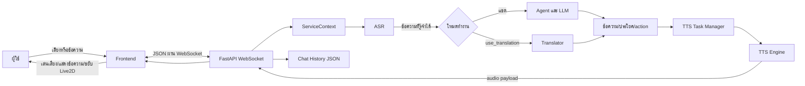

# คู่มือเทคนิค Open-LLM-VTuber (yawidoc)

คู่มือนี้อธิบายโครงสร้างและเส้นทางทำงานของ repository รุ่น `1.2.1` ในเชิงวิศวกรรมซอฟต์แวร์ เหมาะสำหรับอ่านทำความเข้าใจระบบก่อนแก้โค้ดหรือปรับ config โดยใช้โค้ดใน workspace นี้เป็นแหล่งอ้างอิงหลัก

> ขอบเขต: frontend ที่อยู่ใน `frontend/` เป็น build artifact จาก repository แยก ไม่ใช่ source React ที่แก้ไขได้ครบใน repository นี้ เนื้อหาฝั่ง browser จึงอธิบายจาก protocol ของ backend และพฤติกรรมของ bundle ที่มีอยู่

## 1. Mental model: คิดถึงระบบอย่างไร

Open-LLM-VTuber เป็นแอป voice-first ที่ต่อส่วนประกอบหลายชนิดเข้าด้วยกัน:

1. Browser หรือ desktop client เก็บเสียง/ข้อความและแสดง Live2D
2. FastAPI server รับ HTTP และ WebSocket
3. `ServiceContext` เตรียม engine และ config ของ session
4. ASR แปลงเสียงผู้ใช้เป็นข้อความ
5. Agent/LLM สร้างคำตอบ หรือ Translator แปลข้อความโดยตรง
6. TTS สร้างเสียงจากข้อความตอบกลับ
7. WebSocket ส่งข้อความ เสียง และ action กลับไปให้ frontend เล่นและขยับ avatar
8. History manager เก็บบทสนทนาเป็น JSON บนดิสก์

แกนการออกแบบสำคัญคือ **เลือก implementation ผ่าน Factory**: ระบบเรียก interface กลาง แต่ config ตัดสินว่าจะใช้ Ollama, Faster-Whisper, Edge TTS, NLLB หรือ provider ตัวอื่น



## 2. แผนที่ repository

| พื้นที่ | หน้าที่ |
| --- | --- |
| [run_server.py](run_server.py) | Entry point: logger, config sync/validation, สร้าง context และเริ่ม Uvicorn |
| [src/open_llm_vtuber/server.py](src/open_llm_vtuber/server.py) | ประกอบ FastAPI, routes และ static mounts |
| [src/open_llm_vtuber/routes.py](src/open_llm_vtuber/routes.py) | WebSocket routes, ASR HTTP route, web tool และ Live2D info |
| [src/open_llm_vtuber/service_context.py](src/open_llm_vtuber/service_context.py) | Dependency container ที่สร้าง/อัปเดต ASR, TTS, VAD, agent, translator และ MCP |
| [src/open_llm_vtuber/websocket_handler.py](src/open_llm_vtuber/websocket_handler.py) | แปล message type เป็น handler และดูแล connection/session |
| [src/open_llm_vtuber/config_manager/](src/open_llm_vtuber/config_manager/) | Pydantic schema, YAML loading และ validation |
| [src/open_llm_vtuber/agent/](src/open_llm_vtuber/agent/) | Agent, output types, LLM adapters และ factories |
| [src/open_llm_vtuber/asr/](src/open_llm_vtuber/asr/) | Speech recognition providers |
| [src/open_llm_vtuber/tts/](src/open_llm_vtuber/tts/) | Speech synthesis providers |
| [src/open_llm_vtuber/translate/](src/open_llm_vtuber/translate/) | Translation providers เช่น NLLB, DeepLX, Tencent |
| [src/open_llm_vtuber/conversations/](src/open_llm_vtuber/conversations/) | Orchestration ของ turn, streaming, TTS queue และ group chat |
| [src/open_llm_vtuber/chat_history_manager.py](src/open_llm_vtuber/chat_history_manager.py) | อ่าน/เขียน history JSON และตรวจ path |
| [characters/](characters/) | Character config ทางเลือกที่เลือกจากหน้า Settings |
| [model_dict.json](model_dict.json) | Registry ของ Live2D model metadata |
| [live2d-models/](live2d-models/) | ไฟล์ `.model3.json`, `.moc3`, motion, expression และ physics |
| [prompts/](prompts/) | Prompt templates และ prompt loader |
| [frontend/](frontend/) | Browser build artifacts และ asset ที่ server เสิร์ฟ |
| [logs/](logs/) | Log รายวันสำหรับวิเคราะห์ startup และ runtime |

## 3. การเริ่มระบบทีละขั้น

คำสั่งหลักบน Windows, macOS และ Linux ใช้ `uv`:

```powershell
uv sync
uv run run_server.py
```

สำหรับ log ละเอียด:

```powershell
uv run run_server.py --verbose
```

ลำดับใน [run_server.py](run_server.py):

1. ตั้ง `HF_HOME` และ `MODELSCOPE_CACHE` ให้ชี้เข้า `models/` ของ project
2. สร้าง logger ผ่าน Loguru: console และ `logs/debug_YYYY-MM-DD.log`
3. อ่าน version จาก `pyproject.toml`
4. ตรวจว่ามี `frontend/index.html`; ถ้าไม่มีจะพยายาม initialize Git submodule
5. เรียก `UpgradeManager.sync_user_config()` เพื่อ sync/migrate config
6. อ่าน `conf.yaml` ด้วย `read_yaml()` และตรวจผ่าน Pydantic ด้วย `validate_config()`
7. สร้าง `WebSocketServer`
8. เรียก `await server.initialize()` เพื่อโหลด service context และโมเดล
9. เริ่ม Uvicorn บน `system_config.host` และ `system_config.port`

ข้อความ `Uvicorn running on http://localhost:12393` หมายถึง HTTP server เริ่มรับ connection แล้ว หน้าต่าง terminal ต้องเปิดค้างไว้ หาก initialization ล้มเหลว process อาจจบก่อนถึงข้อความนี้ ให้ดู traceback ใน console และ log รายวัน

`--hf_mirror` ตั้ง `HF_ENDPOINT` ก่อนโหลดโมเดลจาก Hugging Face แต่ไม่ใช่การเปลี่ยน provider ของโมเดลโดยตัวมันเอง

## 4. Config: system, character และ config ทางเลือก

### 4.1 โครงสร้างหลัก

[config_manager/main.py](src/open_llm_vtuber/config_manager/main.py) รวม config เป็นสามส่วน:

- `system_config`: server, host/port, prompt map, directory ของ alternative configs และ proxy
- `character_config`: persona, Live2D, Agent/LLM, ASR, TTS, VAD และ translation
- `live_config`: การเชื่อมต่อกับ live-streaming integrations

`read_yaml()` ใน [config_manager/utils.py](src/open_llm_vtuber/config_manager/utils.py) อ่าน YAML, พยายามเดา encoding และแทน `${ENV_VAR}` ด้วย environment variable ก่อน parse ส่วน `validate_config()` สร้าง Pydantic model; ถ้าชนิดข้อมูลหรือ field บังคับไม่ถูกต้อง จะ throw `ValidationError` ก่อนเริ่ม server

Pydantic schema อยู่ใน `config_manager/` เช่น `system.py`, `character.py`, `agent.py`, `asr.py`, `tts.py`, `tts_preprocessor.py`, `stateless_llm.py` และ `vad.py` การเปลี่ยนโครงสร้าง config ต้องพิจารณา schema และ template ทั้ง `config_templates/conf.default.yaml` กับ `conf.ZH.default.yaml`

### 4.2 `conf_name` กับ `conf_uid`

- `conf_name` คือชื่อที่แสดงใน Character Preset
- `conf_uid` คือ ID ภายใน ใช้แยกประวัติสนทนาและ character
- `live2d_model_name` ต้องตรงกับ `name` ใน `model_dict.json`
- `character_name` เป็นชื่อผู้พูดที่แสดงในบทสนทนา
- `persona_prompt` ใช้ประกอบ system prompt ของ Agent

### 4.3 การเลือก character config

`system_config.config_alts_dir` ชี้ไปที่ `characters/` โดยค่าเริ่มต้น backend สแกนไฟล์ `.yaml` และสร้างรายการ `{filename, name}` จาก filename กับ `character_config.conf_name` ตาม [scan_config_alts_directory()](src/open_llm_vtuber/config_manager/utils.py)

ใน frontend เลือกจาก **Settings → General → Character Preset**; เมื่อเลือก preset จะส่ง `switch-config` พร้อมชื่อไฟล์ YAML ไป backend ทันที ไม่ได้ต้องแก้ภาษาในช่องแชต ตัวอย่างใน workspace คือ [characters/translator_pattani_thai.yaml](characters/translator_pattani_thai.yaml)

ใน [ServiceContext.handle_config_switch()](src/open_llm_vtuber/service_context.py) ระบบอ่าน alt YAML แล้ว deep-merge `character_config` เข้ากับ config ปัจจุบัน จากนั้น validate และโหลด engine ที่เปลี่ยน ค่า field ที่ไม่ได้ระบุใน alt config จะ inherit จาก config เดิมตาม merge path นี้ ดังนั้น alternative config ควรระบุค่าที่ต้องการเปลี่ยนให้ชัด และ `conf_uid` ควรไม่ซ้ำ

## 5. ServiceContext และอายุของ object

`ServiceContext` คือ composition root ของ session: เป็นที่รวม reference ของ typed configs และ runtime objects

- `Live2dModel`
- `ASRInterface`
- `TTSInterface`
- `VADInterface | None`
- `AgentInterface`
- `TranslateInterface | None`
- MCP registry/client/tool manager/executor เมื่อเปิดใช้
- system prompt, history UID, client UID และ callback ส่งข้อความ

ตอน server startup `load_from_config()` โหลด config หลักและสร้าง engines ตาม config ผ่าน factories จากนั้นแต่ละ WebSocket connection ได้ `ServiceContext` อีกตัวผ่าน `_init_service_context()`; `load_cache()` clone config models แต่รับ engine references จาก default context เพื่อไม่โหลดโมเดลหนักซ้ำโดยไม่จำเป็น ตัว session ยังมี `client_uid`, `history_uid` และ MCP client state ของตัวเอง

ลำดับตอนโหลด config โดยคร่าวใน `load_from_config()`:

1. สร้าง Live2D จาก `live2d_model_name`
2. สร้าง ASR/TTS/VAD จาก config
3. เตรียม MCP adapter/tools ถ้า `use_mcpp` เปิด
4. สร้าง Agent/LLM
5. สร้าง translation engine ถ้า `translate_audio` เปิด
6. เก็บ typed config ที่โหลดสำเร็จ

ข้อสังเกต: การเลือก config ใหม่ใน session อาจทำให้ต้อง initialize engine ใหม่ โดยเฉพาะ ASR/translator ที่โหลด local model ใช้เวลาและ RAM มากกว่าการส่ง text message ปกติ

## 6. HTTP routes และ WebSocket protocol

### 6.1 Routes สำคัญ

[server.py](src/open_llm_vtuber/server.py) mount routes และ static folders โดย mount เฉพาะก่อน frontend catch-all:

| Path | ชนิด | จุดประสงค์ |
| --- | --- | --- |
| `/client-ws` | WebSocket | connection หลักของ browser/desktop client |
| `/proxy-ws` | WebSocket | proxy mode เมื่อเปิด `enable_proxy` |
| `/tts-ws` | WebSocket | TTS route สำหรับ web tool |
| `/asr` | HTTP POST | upload WAV เพื่อถอดเสียงให้ web tool |
| `/web-tool` | Static/redirect | หน้า web tool |
| `/live2d-models/info` | HTTP GET | สแกน Live2D folders ที่มี model3 file |
| `/cache`, `/live2d-models`, `/bg`, `/avatars` | Static | ไฟล์เสียงและ asset |
| `/` | Static catch-all | frontend build |

### 6.2 Lifecycle ของ `/client-ws`

ใน [routes.py](src/open_llm_vtuber/routes.py):

1. Accept WebSocket
2. สร้าง UUID ของ client
3. `handle_new_connection()` สร้าง session context และเก็บ connection
4. ส่ง initial messages: connection established, `set-model-and-conf`, `group-update`, `start-mic`
5. loop `receive_json()` แล้ว route message ตาม `type`
6. เมื่อ disconnect ทำ cleanup ของ task, group, context และ message handler state

ฝั่ง frontend เมื่อ socket เปิด จะเริ่มต้นด้วย `fetch-backgrounds`, `fetch-configs`, `fetch-history-list`, `create-new-history` เพื่อเติม UI

### 6.3 Message types

| ทิศทาง | `type` | ความหมาย |
| --- | --- | --- |
| client → server | `text-input` | ส่งข้อความพิมพ์เพื่อเริ่ม turn |
| client → server | `mic-audio-data` | ส่ง audio samples เป็น chunk; backend append เข้า buffer |
| client → server | `mic-audio-end` | จบ audio utterance และเริ่มประมวลผล ASR |
| client → server | `fetch-configs` | ขอรายการ config ทางเลือก |
| client → server | `switch-config` | เปลี่ยน character โดยส่ง `file` |
| client → server | `fetch-history-list` | ขอรายการประวัติของ `conf_uid` ปัจจุบัน |
| client → server | `fetch-and-set-history` | โหลด history และเติม Agent memory |
| client → server | `create-new-history` | สร้าง history ใหม่ |
| client → server | `interrupt-signal` | ยกเลิก conversation/TTS ที่กำลังทำงาน |
| client → server | `frontend-playback-complete` | ยืนยันว่า frontend เล่นเสียงครบแล้ว |
| server → client | `set-model-and-conf` | ส่ง Live2D model metadata และ character IDs |
| server → client | `config-files` | รายการ `{name, filename}` สำหรับ preset picker |
| server → client | `audio` | WAV base64, display text, volume envelope และ Live2D actions |
| server → client | `control` | signal เช่น `start-mic`, `conversation-chain-start/end` |
| server → client | `backend-synth-complete` | backend สร้างเสียงครบสำหรับ turn นี้ |
| server → client | `history-list`, `history-data` | ข้อมูลประวัติสนทนา |
| server → client | `error` | ข้อผิดพลาดระดับ application พร้อมข้อความ |

Message จะถูกอ่านเป็น JSON โดย `WebSocketHandler._route_message()` แล้ว lookup ใน `_message_handlers`; type ที่ไม่รู้จักจะลง warning (ยกเว้น playback-complete ซึ่งถูกจัดการโดย message handler อื่น)

### 6.4 Port และ WebSocket URL

HTTP URL กับ WebSocket URL ต้องชี้ server instance และ port เดียวกัน เช่น `http://localhost:12393` คู่กับ `ws://127.0.0.1:12393/client-ws` เมื่อใช้ HTTPS ต้องใช้ `wss://` ไม่ใช่ `ws://`

ใน bundle ที่ติดตั้งอยู่ default WebSocket URL คือ `ws://127.0.0.1:12393/client-ws`; ถ้าแก้ port ใน `conf.yaml` แต่ frontend ยังใช้ port เก่า จะเห็น WebSocket connection/error แม้หน้า HTML จะเปิดได้ การตรวจที่เด็ดขาดที่สุดคือ DevTools → Network → WS แล้วดู URL และ handshake

## 7. เส้นทางสนทนามาตรฐาน: audio → response

จุดเริ่มต้นหลักคือ `handle_conversation_trigger()` ใน [conversation_handler.py](src/open_llm_vtuber/conversations/conversation_handler.py) และการประมวลผลรายคนอยู่ใน [single_conversation.py](src/open_llm_vtuber/conversations/single_conversation.py)

1. Frontend ส่ง text หรือ chunk เสียง
2. ถ้าเป็นเสียง backend buffer samples; เมื่อได้รับ `mic-audio-end` จะย้าย buffer เข้าสู่ conversation task
3. `process_user_input()` เรียก `asr_engine.async_transcribe_np()`; ASR interface ใช้ `asyncio.to_thread()` เป็นค่าเริ่มต้นเพื่อไม่ block event loop
4. ส่ง `user-input-transcription` กลับ frontend
5. สร้าง `BatchInput` ซึ่งรวม text, images, source และ metadata
6. เข้า branch translation mode หรือ Agent mode
7. แปลง output stream เป็น display text, TTS text และ actions
8. สร้างเสียงผ่าน `TTSTaskManager`
9. ส่ง payload `audio` ตามลำดับกลับ client
10. frontend เล่นเสียงและตอบ `frontend-playback-complete`
11. backend ส่ง `force-new-message` และ `conversation-chain-end`
12. บันทึกข้อความ human/AI ลง history เมื่อมี active history

Text input ข้าม ASR ได้โดยตรง จึงเป็นวิธีทดสอบ translation/LLM โดยไม่ต้องวินิจฉัยไมค์พร้อมกัน

## 8. Agent และ LLM: โหมดคุยปกติ

`AgentFactory.create_agent()` เลือก agent จาก `conversation_agent_choice`; สำหรับ `basic_memory_agent` จะอ่าน `agent_settings.basic_memory_agent.llm_provider` แล้วเรียก `LLMFactory.create_llm()`

### 8.1 Agent ไม่ใช่ LLM

- **Agent** คุม memory, ประกอบ messages, จัดการ tool calls, แบ่ง output และ interruption
- **LLM provider** ติดต่อ model/API เพื่อสร้าง token stream
- **TTS** แปลงประโยคที่ได้เป็นเสียง

`BasicMemoryAgent` เก็บ `_memory` เป็น list ของ `{role, content}` แยกจาก JSON chat history บน disk เมื่อโหลด history จะใช้ `set_memory_from_history()` เพื่อสร้าง memory ใหม่ การเรียก LLM ปกติจึงส่ง context ที่สะสมอยู่ ไม่ใช่เพียงข้อความล่าสุด

### 8.2 Stateless LLM providers

`StatelessLLMConfigs` เป็น pool ของการตั้งค่า provider ส่วน `llm_provider` เลือกว่าจะใช้ config ก้อนใด Factory รองรับ OpenAI-compatible providers, Ollama, Claude, Llama.cpp และอื่น ๆ ที่ลงทะเบียนไว้

สำหรับ Ollama ต้องให้ `base_url` ตรงกับ service และ `model` ตรงกับชื่อที่ `ollama list` แสดง (รวม tag) ตัวอย่างที่ใช้ใน workspace นี้คือ `qwen3:8b` ที่ `http://localhost:11434/v1` หากใช้ชื่อโมเดลที่ไม่มี server จะตอบ error เช่น 404 model not found; นี่ต่างจาก WebSocket port ซึ่งอยู่ที่ 12393

### 8.3 Streaming และ preprocessing

ใน `BasicMemoryAgent` output ถูกประมวลผลเป็นสาย decorator ใน [transformers.py](src/open_llm_vtuber/agent/transformers.py):

1. `sentence_divider`: แบ่ง token stream เป็นประโยค (`regex` หรือ `pysbd`) และช่วยส่งคำตอบแรกเร็ว
2. `actions_extractor`: ดึง emotion tags เช่น `[joy]` ไปเป็น Live2D expressions
3. `display_processor`: เตรียมข้อความที่จะแสดง รวมการจัดการ think tags
4. `tts_filter`: ตัด special chars/ข้อความใน think tags และเตรียม string สำหรับพูด

ข้อดีของ streaming คือไม่จำเป็นต้องรอคำตอบทั้งหมดก่อนเริ่มสร้างเสียง ส่วน `faster_first_response` และ `segment_method` คุม tradeoff ระหว่างความหน่วงกับวิธี segmentation

## 9. ASR, translation และ profile มลายูปัตตานี

### 9.1 ASR interface และ factory

ทุก ASR มี contract หลักคือ `transcribe_np(audio) -> str`; `async_transcribe_np()` เรียกงาน synchronous ใน thread โดยปริยาย Factory ใน [asr_factory.py](src/open_llm_vtuber/asr/asr_factory.py) เลือก provider เช่น Faster-Whisper, Sherpa-ONNX, FunASR, Whisper.cpp, Azure หรือ Groq

เสียงที่ server เก็บอยู่ในรูป NumPy array; interface กำหนด sample rate 16 kHz, mono, 16-bit sample width เป็นค่าพื้นฐานสำหรับ helper แปลงไฟล์

### 9.2 Translation mode เทียบกับแปล TTS

มี concept ที่ชื่อคล้ายกันแต่ทำงานคนละจุด:

- `character_config.use_translation: true`: **แทนที่ Agent/LLM สำหรับ incoming user text** ด้วย translator ตรง ๆ
- `tts_preprocessor_config.translator_config.translate_audio: true`: เปิด translation engine ซึ่งในโหมดปกติอาจใช้แปลข้อความตอบก่อนส่งให้ TTS

ใน `single_conversation.py` ถ้า `use_translation` เป็น true และ translator ถูกสร้างแล้ว จะเรียก `translate_engine.translate(input_text)` โดยตรง ไม่เรียก agent chat stream นี่คือโหมด translator profile

### 9.3 Profile ใน workspace นี้

[characters/translator_pattani_thai.yaml](characters/translator_pattani_thai.yaml) ประกอบ pipeline ดังนี้:

| ขั้น | ค่าปัจจุบัน | ความหมาย |
| --- | --- | --- |
| ASR | `faster_whisper` | ถอดเสียงจาก audio เป็นข้อความ |
| ASR language | `ms` | บอก Faster-Whisper ว่า input เป็น Malay |
| ASR model | `large-v3-turbo` (GPU, `int8_float16`, `vad_filter: true`) | Whisper รุ่นมาตรฐาน โหลดไว้ที่ `models/whisper` ด้วย `download_models.py` |
| ASR prompt | คำศัพท์โรงพยาบาลภาษามลายู | ช่วยให้ Whisper ได้ยินคำทางการแพทย์ถูกขึ้น |
| Translator | `pattani_thai` | ตารางวลี (`pattani_dataset/medical_phrases.jsonl`) → NLLB → LLM ตรวจและแปลใหม่เมื่อคำแปลไม่เข้ากับบริบทโรงพยาบาล |
| Source language | `zsm_Latn` | Standard Malay, Latin script, FLORES-200 code (ใช้ภายใน NLLB) |
| Target language | `tha_Thai` | ภาษาไทย, FLORES-200 code |
| TTS | `edge_tts` | เสียง `th-TH-PremwadeeNeural` และเสียงสำรอง `th-TH-NiwatNeural` |
| `use_translation` | `true` | ข้าม LLM และแปลข้อความจาก ASR โดยตรง |
| VAD | ปิด (`null`) | frontend endpointing เป็นผู้กำหนดจบ utterance ตาม profile comment |

`NLLBTranslator` โหลด tokenizer/model, แปลง token โดยกำหนด `forced_bos_token_id` ของ target language แล้ว decode ผล หากแปลล้มเหลวจะ log error และคืนข้อความเดิม เพื่อไม่ให้ translator exception ทำลาย conversation turn

ตารางวลีและคลังคำทั้งหมดสร้างจากข้อมูลต้นทางด้วย `uv run python build_phrasebook.py` (บทสัมภาษณ์, `glossary.jsonl` และคลังคำใน `data_thai_to_pattani/*.csv`) และตรวจทั้งสองทิศทางได้ด้วย `uv run python test_word_bank.py`

ข้อจำกัดสำคัญ: ASR และ NLLB ใน profile นี้เป็น local (เมื่อ model อยู่ในเครื่อง) แต่ `edge_tts` ติดต่อบริการเครือข่าย จึงไม่ใช่ pipeline ที่ offline ได้ทั้งหมด

### 9.4 Proactive greeting

เมื่อ client ส่ง `ai-speak-signal`, backend เรียก proactive prompt path ใน translation profile มี greeting พิเศษ hard-coded ใน `single_conversation.py`: แสดงไทยพร้อม Jawi แต่ส่งเฉพาะบรรทัดไทยเข้า TTS การเห็น greeting นี้ตอนเริ่ม session จึงไม่ใช่การแปลประโยคผู้ใช้ และไม่ใช่ LLM generation

### 9.5 หน้าล่าม (`/interpreter`)

หน้า [interpreter/index.html](interpreter/index.html) เป็นหน้าเว็บแยกจาก frontend หลัก เปิดที่ `http://localhost:12393/interpreter/` มีสวิตช์ **ผู้ป่วยพูด / แพทย์พูด** และคุยกับ backend ผ่าน `/interpreter-ws` ([routes.py](src/open_llm_vtuber/routes.py) → `init_interpreter_route()`)

- **แพทย์พูด** ไม่มีการแปลด้วยเครื่อง: ข้อความไทย (เลือกจากหมวด, พิมพ์ค้นหา หรือพูด) ถูกจับคู่กับคลังประโยคมาตรฐาน `pattani_dataset/standard_sentences.jsonl` ด้วย [sentence_bank.py](src/open_llm_vtuber/interpreter/sentence_bank.py) (ตัดคำด้วย PyThaiNLP `newmm`, คะแนน = ค่าเฉลี่ยของความเหมือนระดับตัวอักษร (rapidfuzz) กับ TF-IDF cosine ระดับคำ)
- **แถบ "ใช้บ่อย"** (บนสุดของหน้าแพทย์พูด): ปุ่มลัด 12 ประโยค/คำจากคลังประโยคมาตรฐาน กดครั้งเดียวเพื่อเล่นเสียง เรียงตามจำนวนครั้งที่แพทย์เลือกใช้จริง (นับทุกครั้งที่ `play`, เก็บใน `logs/interpreter_usage.json`) แล้วเติมด้วยรายการเริ่มต้นใน `pattani_dataset/quick_sentences.json` (แก้ไขได้ ต้องเป็นข้อความไทยที่ตรงกับประโยคในคลัง) แถบจะจัดลำดับใหม่เมื่อเปิดหน้าแพทย์พูดเท่านั้น ปุ่มจึงไม่ขยับระหว่างใช้งาน ประโยคที่มีตัวเลขหรือความถี่ยังต้องยืนยันก่อนเล่นเหมือนเดิม
- **กฎความปลอดภัย**: คะแนนต่ำกว่า threshold → แสดง "ไม่พบประโยค กรุณาใช้ล่าม" และไม่มีเสียง; สูงกว่า → แสดง 1–3 ประโยคให้แพทย์เลือกก่อน จึงจะเล่นเสียง; ประโยคที่มีตัวเลขหรือความถี่ต้องยืนยันอีกครั้ง; threshold มาจากข้อมูลทดสอบ (`uv run python calibrate_matcher.py` เขียน `pattani_dataset/matcher_threshold.json`)
- **ผู้ป่วยพูด** (หน้าแรกที่เปิด) ใช้ ASR และ translator ของ `translator_pattani_thai.yaml` (แปลด้วยเครื่อง): ปุ่มใหญ่ปุ่มเดียว กดเพื่อพูด / กดเพื่อหยุด, สถานะ "พร้อม" / "กำลังฟัง" / "กำลังแปล" หรือข้อความผิดพลาด, ข้อความมลายูที่ได้ยิน (เล็ก) และคำแปลไทย (ใหญ่ อ่านได้จากระยะ 1 เมตร), ปุ่มเล่นซ้ำ และปุ่มล้างหน้าจอ
- **สถานะเครือข่าย**: ASR และการแปลทำงานในเครื่อง มีเพียงเสียงพูด (edge-tts) ที่ต้องใช้อินเทอร์เน็ต หน้าเว็บจึงแสดง "ออนไลน์" หรือ "ไม่มีอินเทอร์เน็ต: แสดงข้อความเท่านั้น" (server ตรวจการเชื่อมต่อไปยังบริการเสียง, `InterpreterService.online()`) เมื่อไม่มีอินเทอร์เน็ตจะได้ข้อความแปลตามปกติแต่ไม่มีเสียง
- **ป้ายมุมจอ** (แสดงตลอด): "ต้นแบบ – ยังไม่ได้ตรวจสอบความแม่นยำ ห้ามใช้ประกอบการตัดสินใจทางการแพทย์ หากไม่แน่ใจให้ใช้ล่ามที่เป็นคน"
- **โหมดทดสอบ**: เปิด `http://localhost:12393/interpreter/?test=1` จะมีส่วนให้คะแนนคำแปล (ถูกต้อง / ผิดเล็กน้อย / ผิดร้ายแรง) และช่องพิมพ์คำมลายูแทนการพูด ส่วนนี้ไม่แสดงเมื่อเปิดหน้าแบบปกติ คะแนนถูกบันทึกต่อท้ายไฟล์ `logs/interpreter_ratings.jsonl` (เวลา, ข้อความที่ได้ยิน, คำแปล, คะแนน; ไม่บันทึกเสียง; ให้คะแนนซ้ำได้ บรรทัดล่าสุดของแต่ละ `id` คือคะแนนที่ใช้)
- Protocol: `doctor_text` / `doctor_audio` → `candidates [{id, score, thai}]` → `play {id}` → `audio_url`; `list_categories`, `list_sentences`, `list_quick` → `quick [{id, thai, check_numbers, count}]`; `patient_text` / `patient_audio` → `patient_translation {id, heard, thai, audio_url, online}`; `rate {id, rating}` → `rated`; `network_status` → `network_status {online}`
- ทดสอบ: `uv run python test_interpreter.py` (เพิ่ม `--speech` เพื่อทดสอบเสียง)

### 9.6 แถบ "ใช้บ่อย" ในหน้าหลัก (หน้าที่มี avatar)

แถบปุ่มลัดประโยค/คำที่ใช้บ่อยแสดงอยู่ด้านบนของ avatar ในหน้าหลัก (`http://localhost:12393/`) ใช้สี ฟอนต์ และรูปทรงเดียวกับหน้าเว็บ กดครั้งเดียว avatar จะพูดประโยคนั้นเป็นภาษามลายูปัตตานี และข้อความขึ้นในแชตกับ subtitle ตามปกติ

- แสดงกับทุก character กดที่คำว่า "ใช้บ่อย" เพื่อซ่อน/แสดงแถบ ถ้า character ไม่ใช่ตัวแปลไทย/ปัตตานี (เช่น Mao ซึ่งใช้เสียงอังกฤษ) ประโยคจะถูกพูดด้วยเสียงของ `translator_thai_pattani.yaml` แทน เพราะเสียงของ character นั้นอ่านอักษรไทยไม่ได้
- **แถบเปลี่ยนตามทิศทางการแปลของ character** (server ตรวจจาก `translate_provider` ของ character ใน session นั้น, `quick_direction()` ใน [service.py](src/open_llm_vtuber/interpreter/service.py)) และมีป้ายบอกทิศทางใต้คำว่า "ใช้บ่อย":
  - **ไทย → ปัตตานี** (`translator_thai_pattani.yaml` และ character อื่นทั้งหมด): ปุ่มเป็นประโยคไทย กดแล้ว avatar พูดเป็นปัตตานี
  - **ปัตตานี → ไทย** (`translator_pattani_thai.yaml`): ปุ่มเป็นประโยคปัตตานี (อักษรไทย, วางเมาส์เพื่อดูความหมายไทย) กดแล้ว avatar พูดเป็นภาษาไทย
- ประโยคมาจากคลังประโยคมาตรฐานเดียวกับหน้า `/interpreter` (ข้อ 9.5): 12 ประโยคที่เลือกใช้บ่อยที่สุดของแต่ละทิศทาง เติมด้วยรายการเริ่มต้นใน `pattani_dataset/quick_sentences.json` (มี 2 รายการ: `thai_pattani` และ `pattani_thai` ทั้งคู่เขียนเป็นข้อความไทยของประโยคในคลัง) จำนวนครั้งที่ใช้เก็บแยกตามทิศทางใน `logs/interpreter_usage.json`
- avatar พูดข้อความของคลังประโยคโดยตรง **ไม่ผ่านการแปลด้วยเครื่องและไม่ผ่าน LLM** ประโยคที่มีตัวเลขหรือความถี่จะถามยืนยันก่อน ปุ่มจะกดไม่ได้ระหว่างที่ avatar กำลังพูด
- แถบนี้เป็นสคริปต์ [frontend_addons/quick_bar.js](frontend_addons/quick_bar.js) ที่ `frontend/index.html` โหลดก่อนสคริปต์ของแอป (frontend เป็น bundle ที่ compile แล้ว จึงเพิ่มเป็นสคริปต์แยก) `frontend/` เป็น git submodule การแก้ไขในนั้น commit ลง repo นี้ไม่ได้ ดังนั้นถ้าอัปเดต frontend แล้ว `index.html` ไม่มีบรรทัดนี้ server จะแทรกให้เองตอนส่งหน้า (`FrontendStaticFiles` ใน [server.py](src/open_llm_vtuber/server.py)) และส่ง `index.html` แบบ `Cache-Control: no-cache`
- สคริปต์คุยผ่าน `/client-ws` เดิมของหน้า ด้วย message ใหม่ 2 ชนิดใน [websocket_handler.py](src/open_llm_vtuber/websocket_handler.py): `fetch-quick-phrases` → `quick-phrases {direction, phrases: [{id, label, thai, check_numbers, count}]}` และ `quick-phrase {id, direction}` → เริ่ม conversation turn ตามปกติ (metadata `quick_phrase` ใน [single_conversation.py](src/open_llm_vtuber/conversations/single_conversation.py))
- หลังอัปเดตโค้ดต้อง restart server แล้ว **โหลดหน้าเว็บใหม่ (Ctrl+Shift+R)** แท็บที่เปิดค้างไว้จะเชื่อมต่อกลับเองโดยยังใช้หน้าเก่าที่ไม่มีแถบ
- แถบนี้ไม่แสดงใน desktop client (Electron) เพราะ client นั้นใช้ frontend ของตัวเอง ไม่ได้โหลดหน้าจาก server

## 10. TTS, audio payload และ latency

ทุก TTS implement `generate_audio()`; interface มี async wrapper ที่ส่งงาน synchronous ไป thread โดยปริยาย

`TTSTaskManager` ทำงานสองอย่างพร้อมกัน:

- สร้าง audio tasks ได้ขนาน เพื่อไม่ให้การรอ TTS ประโยคก่อนหน้าบล็อกการเริ่มสร้างประโยคถัดไป
- sequence payload ด้วย queue/counter เพื่อส่งเสียงกลับ frontend ตามลำดับประโยคเดิม

`prepare_audio_payload()` โหลดไฟล์เสียง แปลงเป็น WAV, base64 encode และคำนวณ volume ต่อ chunk (ค่าเริ่มต้น 20 ms) พร้อม `display_text`, `actions`, `slice_length` และ `forwarded` ส่งผ่าน WebSocket เมื่อส่งเสร็จ frontend แจ้ง playback completion; cache audio file จะถูกลบหลังสร้าง payload

Latency จึงประกอบจากหลายช่วง: ASR, translation หรือ LLM first token, segmentation, TTS, network และ browser playback การเปิด local model ไม่ได้แปลว่าทั้ง pipeline เป็น offline หรือเร็วเท่ากันทุกเครื่อง

## 11. Live2D และการ map action

`live2d_model_name` ใช้หา record ใน [model_dict.json](model_dict.json) ไม่ได้เดาชื่อไฟล์เอง Record มี `url`, scale/offset, emotion map และ tap motions

`Live2dModel` เก็บ metadata, `emo_map` และช่วย parse `[emotion]` tags; frontend โหลด URL เช่น `/live2d-models/mao_pro/runtime/mao_pro.model3.json` จาก `set-model-and-conf` แล้ว renderer ใช้ Live2D assets ที่เกี่ยวข้อง

ตรวจ model ที่หายตามลำดับ:

1. `conf_name`/`live2d_model_name` ถูกส่งใน `set-model-and-conf` หรือไม่
2. `live2d_model_name` มีใน `model_dict.json` หรือไม่
3. `url` ชี้ `.model3.json` ที่มีอยู่จริงหรือไม่
4. Network tab โหลด model3, moc3 และ assets ที่อ้างจาก model3 ได้หรือไม่

Error path เช่น `undefined/undefined.model3.json` มักแปลว่า frontend ยังไม่มี model metadata ที่ถูกต้อง ไม่ใช่แปลว่าไฟล์ตัวละครทุกไฟล์หายโดยอัตโนมัติ

## 12. MCP และเครื่องมือของ Agent

MCP (Model Context Protocol) เพิ่ม tool servers ให้ Agent เรียกใช้ เช่น time หรือ search โดย config ของ `basic_memory_agent` มี `use_mcpp` และ `mcp_enabled_servers`

เมื่อเปิด MCP, `ServiceContext` จะเตรียม `ServerRegistry`, `ToolAdapter`, ดึง tool descriptions, แปลง schema สำหรับ LLM providers, สร้าง `ToolManager` และ `ToolExecutor` แล้ว Agent จึงส่ง tool calls ไป execute และรับผลกลับเข้า conversation loop หากไม่ต้องใช้ tools ปิด `use_mcpp` ลด service ที่ต้องเริ่มและจุดผิดพลาดตอน initialization ได้

Error ของ MCP กับ error จาก Ollama/ASR/TTS เป็นคนละชั้น ควรดู module/function ใน log ก่อนสรุปว่าเป็นปัญหา LLM

## 13. Chat history และ state

`chat_history_manager.py` เก็บไฟล์ไว้ที่ `chat_history/<conf_uid>/<history_uid>.json`:

- record แรกเป็น metadata พร้อม timestamp
- ต่อจากนั้นเป็น human/AI messages และ optional name/avatar
- UID ถูก sanitize เพื่อกัน path separator/path traversal
- `get_history()` ตัด metadata ออกก่อนส่งกลับ UI
- `get_history_list()` ค้นหา latest message และเรียงใหม่ไปเก่า

`conf_uid` ทำให้ history ของ character หนึ่งไม่ปะปนกับอีก character หนึ่ง การเปลี่ยน character จึงอาจเห็นรายการ history คนละชุด

มี state อยู่สามชั้นที่ไม่ควรสับสน:

1. React/UI state: แสดงข้อความและ state ของ audio playback
2. `ServiceContext`/Agent memory: context ที่ใช้สร้างคำตอบใน session
3. JSON history: ข้อมูลที่ persist ข้ามการปิดโปรแกรม

## 14. การยกเลิกและอาการพูดวน

`interrupt-signal` ผ่าน `useInterrupt` ฝั่ง frontend จะหยุด playback, เคลียร์ audio queue, เปลี่ยน AI state เป็น interrupted และส่งข้อความให้ backend ยกเลิก conversation task; backend เรียก `agent_engine.handle_interrupt()` เพื่อบันทึกข้อความที่พูดไปแล้วและ marker `[Interrupted by user]`

ระบบประกาศรองรับ voice interruption โดยไม่ต้องใช้ headphones แต่ในห้องที่เปิดลำโพงดังหรือไมค์ไวมาก เสียง TTS อาจถูกไมค์รับกลับเป็น input ได้ หากเกิดการแปล/ตอบซ้ำ ให้หยุดเสียงและแยกไมค์จากลำโพงหรือใช้หูฟังเพื่อตรวจว่าเป็น acoustic feedback ก่อนแก้ model/prompt

## 15. Troubleshooting แบบแยกชั้น

| อาการ | ตรวจที่ไหนก่อน | ความหมายที่พบบ่อย |
| --- | --- | --- |
| `error.websocketNotOpen` | Browser Network → WS, URL และ port ใน `conf.yaml` | frontend ส่ง message ตอน WebSocket ยังไม่ `OPEN`; URL/port ไม่ตรง, server ไม่ได้ start หรือ connection ถูกปิด |
| UI ขึ้น Connected แต่ chat endpoint error | `logs/debug_YYYY-MM-DD.log` และ provider response | transport ใช้ได้แล้ว แต่ LLM/API/agent generation ล้มเหลว เช่น model tag ไม่พบหรือ key/url ผิด |
| `model ... not found` จาก Ollama | `ollama list`, `ollama show <name>`, `ollama_llm.model` | ชื่อ model/tag ใน config ไม่ตรงกับ model ที่ Ollama ติดตั้ง |
| ตัวละครหายหรือ model URL เป็น `undefined` | WebSocket `set-model-and-conf`, Character Preset, registry URL | frontend ไม่ได้รับ metadata หรือเลือก config/model registry ไม่ตรง |
| ไม่เห็น Pattani translator ใน preset | `config_alts_dir`, YAML syntax, `conf_name`, `fetch-configs` response | config ไม่ถูกสแกนหรือ WebSocket ยังไม่เชื่อมกับ backend ตัวที่ถูกต้อง |
| พูด/แปลซ้ำ | ตรวจ input transcription และเสียงที่ไมค์รับ | อาจเป็นเสียงลำโพง loop กลับเข้าไมค์; ลองปิดเสียง/ใช้หูฟังและทดสอบ text input |
| server จบด้วย exit code 1 | console traceback และ log วันปัจจุบัน | startup failure ระหว่าง validate/load model/MCP/port bind; exit code อย่างเดียวไม่ระบุ root cause |
| โหลด model ครั้งแรกช้า | startup log, model path, CPU/GPU และ cache | local model อาจต้องอ่านไฟล์ใหญ่หรือดาวน์โหลดก่อนใช้งาน |

แนวทางอ่าน log: เริ่มจาก timestamp ล่าสุด หา `ERROR`, traceback และข้อความก่อนหน้าทันที แยก `Server context initialized successfully` (โหลด engine ผ่าน) ออกจาก `Uvicorn running ...` (HTTP listener เริ่มแล้ว) เพราะเป็นคนละ milestone

## 16. วิธีทดสอบและพัฒนาต่อ

คำสั่งที่ใช้กับ repository นี้:

```powershell
uv sync
uv run run_server.py
uv run run_server.py --verbose
uv run python test_translator_pipeline.py
uv run python test_ws_translation.py
uv run ruff check .
uv run ruff format .
```

- `test_translator_pipeline.py` ทดสอบ config → สร้างตัวอย่างเสียง → ASR → NLLB → TTS โดยตรง ต้องมี dependencies/models และ Edge TTS ใช้เครือข่าย
- `test_ws_translation.py` ทดสอบ WebSocket จริง: connect → switch config → proactive greeting → text input → translation/audio; ต้องเปิด server ก่อน
- เริ่ม debug จากชั้นล่างสุดที่ล้มเหลว: config validation → engine initialization → route/WS handshake → input transcription → translation/LLM → audio generation → frontend playback

### เพิ่ม provider ใหม่

1. กำหนด config schema ใน `config_manager/` และเพิ่ม field ที่เลือก provider
2. สร้าง implementation ตาม interface เช่น `ASRInterface`, `TTSInterface`, `TranslateInterface` หรือ `StatelessLLMInterface`
3. เพิ่ม branch ใน Factory ที่ตรงกัน
4. เชื่อมการ init ใน `ServiceContext` หาก provider ต้องการ lifecycle พิเศษ
5. เพิ่ม default YAML ทั้งภาษาและ docs ที่อธิบาย dependency/secrets/device
6. เพิ่ม test ที่ตรวจ config และ data path โดยไม่ต้องทดสอบทุก integration พร้อมกัน

### เปลี่ยน config โดยไม่แก้โค้ด

1. คัดลอก config ที่เหมาะสมไว้ใน `characters/`
2. เปลี่ยน `conf_name` ให้จำง่าย และกำหนด `conf_uid` ที่ไม่ซ้ำ
3. ตั้ง provider/model/language/voice และ paths ให้ตรงกับไฟล์จริง
4. validate โดยใช้ `uv run python -c "from src.open_llm_vtuber.config_manager import read_yaml, validate_config; validate_config(read_yaml('characters/your_config.yaml')); print('valid')"`
5. เปิด Settings → General → Character Preset แล้วเลือก config

## 17. สูตรจำสำหรับสอบปากเปล่า

- **ใครรับผิดชอบเลือก engine?** Factory เลือก implementation; config เลือกชื่อ provider; `ServiceContext` จัด lifecycle และเก็บ reference
- **ทำไมใช้ WebSocket?** ต้องส่ง audio chunks, partial responses, control signals, interruption และ playback acknowledgements แบบสองทิศทางโดยไม่เปิด HTTP request ใหม่ทุก event
- **ASR กับ Translation ต่างกันอย่างไร?** ASR แปลงคลื่นเสียงเป็นข้อความ; Translation แปลงข้อความภาษาหนึ่งเป็นอีกภาษา
- **Agent กับ LLM ต่างกันอย่างไร?** Agent คุม state/memory/tools/output policy; LLM เป็น model/provider ที่สร้างข้อความ
- **ทำไม TTS ต้องมี manager?** เพื่อสร้างเสียงได้ขนานแต่คงลำดับข้อความตอนส่งกลับ
- **ทำไมมี `conf_uid`?** เป็น namespace สำหรับ history และ identity ของ config ไม่ใช่ชื่อไฟล์โมเดล
- **ทำไม chat error เกิดได้ทั้งที่ Connected?** Connected ยืนยัน transport; ไม่ได้ยืนยันว่า downstream LLM/ASR/TTS ทำงานสำเร็จ
- **ทำไม model หายได้ทั้งที่ไฟล์ยังอยู่?** renderer ต้องได้รับ metadata และ URL ที่ถูกต้องผ่าน config/WebSocket ด้วย
- **ทำไม error หนึ่งจุดไม่ควรรีบแก้ทุกอย่าง?** ระบบเป็น pipeline; ระบุ stage ที่ล้มเหลวก่อนเพื่อไม่ให้แก้ชั้นที่ทำงานปกติอยู่แล้ว

## 18. Glossary

- **ASR**: Automatic Speech Recognition, speech-to-text
- **TTS**: Text-to-Speech, text-to-audio
- **LLM**: Large Language Model
- **Agent**: ชั้น orchestration รอบ LLM ซึ่งอาจมี memory และ tools
- **VAD**: Voice Activity Detection, ตรวจช่วงที่มีเสียงพูด
- **WebSocket**: connection สองทางแบบต่อเนื่อง
- **MCP**: protocol สำหรับให้ Agent discover/call external tools
- **Factory**: object ที่เลือกและสร้าง implementation ตาม provider/config
- **Session context**: state ของการเชื่อมต่อ client หนึ่งราย
- **Preset/alternative config**: YAML ของ character ที่ merge เข้ากับ base character config
- **FLORES-200 code**: รหัสภาษา NLLB เช่น `zsm_Latn` และ `tha_Thai`
- **Playback acknowledgement**: message จาก frontend ระบุว่า audio queue เล่นเสร็จแล้ว

---

คู่มือนี้มุ่งอธิบายโค้ดและ config ที่มีอยู่จริงใน repository; รายละเอียด UI ภายใน frontend อาจต่างตาม build ที่มาจาก submodule และเวอร์ชันของ frontend ที่ติดตั้ง
